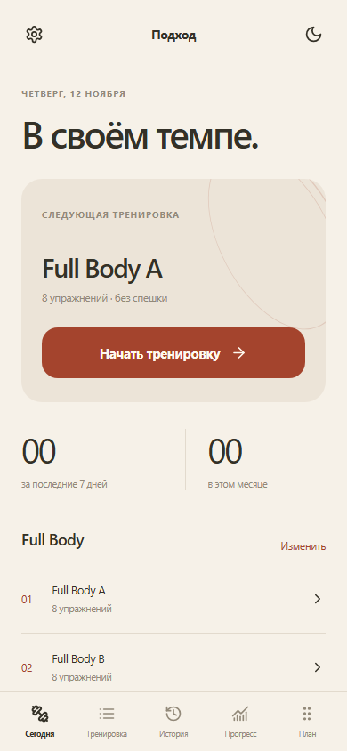
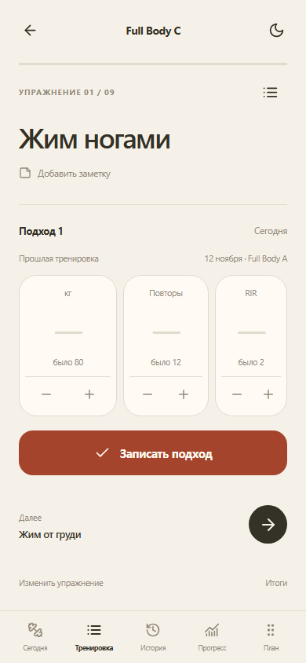
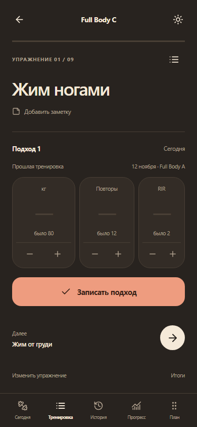

# Подход

Персональный дневник силовых тренировок для iPhone. Записывайте подходы, следите за прогрессом и меняйте программу под себя — без регистрации.

**[Открыть приложение](https://smal1ik.github.io/trainer_log/)**

## Возможности

- Вес, повторения и RIR для каждого подхода. Прошлые результаты видны прямо под полями ввода.
- Свободное количество подходов, автоматическое сохранение и продолжение незавершённой тренировки.
- Редактируемые программы: свои упражнения, замены, перестановки, копирование и архив.
- История по упражнениям, графики веса, повторений и объёма.
- Личные заметки и опциональный таймер отдыха.
- Резервные копии JSON, экспорт истории для анализа и импорт программы от LLM.
- Светлая и тёмная темы, установка на домашний экран и работа без интернета после первой загрузки.

## Интерфейс

  

Скриншоты опубликованного приложения. Результаты на них демонстрационные.

## Технологии

React · TypeScript · Vite · Dexie / IndexedDB · Workbox.

Данные хранятся на устройстве, серверная база и аккаунт не нужны. Приложение размещено на GitHub Pages. Для переноса дневника между устройствами используется резервная копия.
